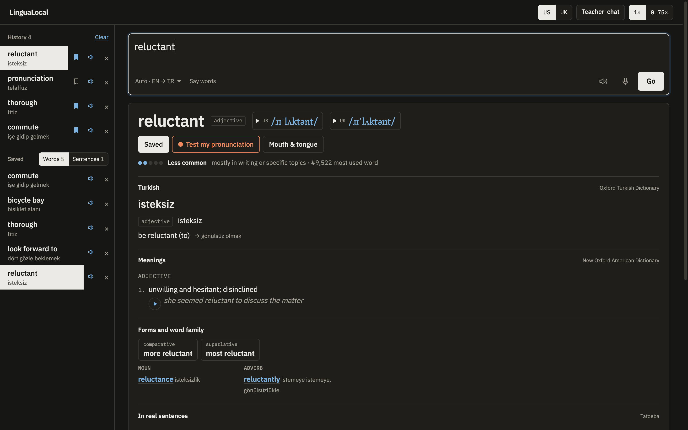
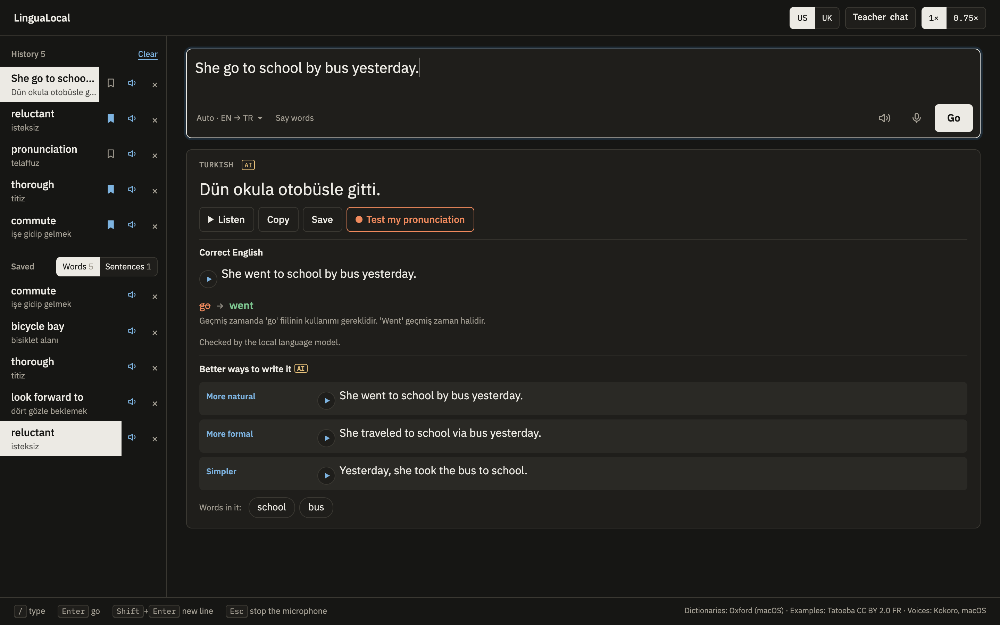
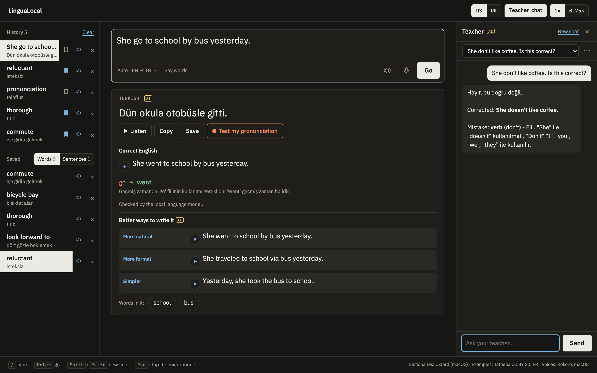
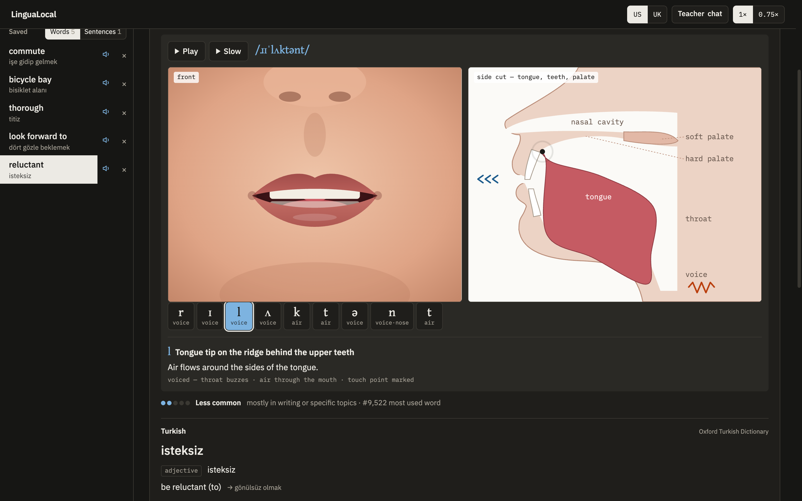
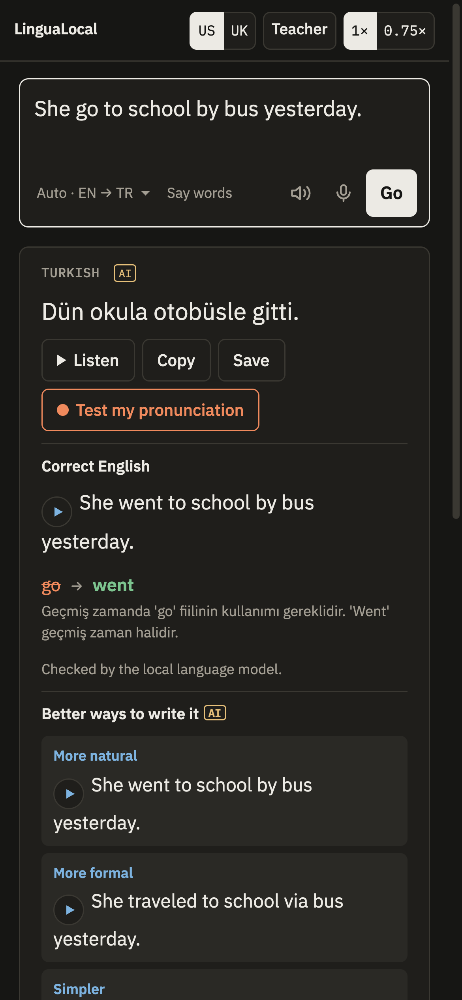

# LinguaLocal

**An English ⇄ Turkish tutor on a local LLM, with an MCP server. Local-first, built for macOS.**

-2f6f4f)


Type or say a word or a sentence in English or Turkish. One screen gives you:

- a translation and corrections, with the reasons in Turkish;
- better ways to write it;
- a word card from the Oxford dictionaries;
- a natural voice, a mouth and tongue animation, and a pronunciation test;
- an AI teacher.

The language model runs **locally** through [Ollama](https://ollama.com). There are no API keys and no paid services,
and your sentences never go to a cloud LLM. A few features use free public services; [Security](#security) lists
them. The same language tools are open to AI assistants through an **MCP server**.



## Overview

| Part | Port | Role |
|---|---|---|
| **LinguaLocal web app** (this folder) | 8767 | The single-page app and your data (history, saved words, teacher chats) in SQLite |
| **[Language Services](language-services/)** | 8770 | A reusable local language API with an **MCP server** on top. It provides translation, writing checks, word cards, voice, pronunciation scoring and the teacher chat. |

```
Browser (Chrome) ──► LinguaLocal :8767 ──► SQLite (your data)
       │
       └──────────► Language Services :8770 ──► Ollama · gemma3:12b (local LLM, priority queue)
                            ▲                ├─► macOS Oxford dictionaries (Dictionary Services)
 AI assistant ── MCP ───────┘                ├─► Kokoro voice (ONNX, local) · macOS voice "Yelda"
 (Claude Code, …)  mcp_server.py             └─► wordfreq · lemminflect · Tatoeba examples
```

**Built for macOS.** LinguaLocal relies on what the Mac and the browser provide:

- the **Oxford dictionaries that ship with macOS**;
- the **macOS speech synthesizer** (`say`, Turkish voice *Yelda*);
- **LaunchAgents**, which start the servers at login;
- the browser's **Web Speech API** for dictation and the pronunciation test.

It was developed and tested on macOS only.

## Key Features

- **Local LLM translation.** Words come from the Oxford Turkish Dictionary (the model fills in the few basic words
  it lacks). Sentences are translated by the local
  model `gemma3:12b` (median 1.75 s on the test set). You also get up to three alternative translations, each named by
  its nuance.
- **Writing help.** The app corrects wrong words, wrong prepositions and grammar, with the reason for each fix in
  Turkish. It also offers up to three better versions: more natural, more formal and simpler.
- **Trusted word cards.** These include:
  - meanings by frequency, with Turkish for each meaning;
  - US/UK IPA, verb forms and 13 tenses;
  - whether a verb takes *-ing* or *to*, prepositions, phrasal verbs and the word family;
  - frequency, typical mistakes of Turkish speakers, and real example sentences.

  Each part comes from the most reliable source available. Anything the model adds is marked **AI**.
- **Unlisted words.** For a phrase the dictionaries lack (*bicycle bay*), the local model explains it, marked AI.
- **Voice and pronunciation:**
  - natural English voice (Kokoro, US/UK, normal or slow) and the macOS Turkish voice;
  - **Mouth & tongue**: a face and a side cut of the mouth, timed to the voice;
  - a pronunciation test with a 0–100 score.
- **Teacher chat.** An AI English teacher checks your sentences and runs exercises. A **quiz from your saved words** is
  chosen and graded by code, not by the model.
- **MCP server.** Five read-only tools over stdio for MCP clients: `translate`, `check_english`, `rewrite_english`,
  `word_card` and `example_sentences`.
- **Local by default.** Both servers listen on `127.0.0.1` only, and your text is never logged.

## Quality Assurance

An app that teaches a language must not teach anything wrong, so testing is central to this project. The full test
plan is in **[docs/TESTING.md](docs/TESTING.md)**. It contains:

- quality goals and a risk analysis;
- the test strategy, entry and exit criteria, and requirements traceability;
- test cases with acceptance criteria, a defect log, a test report and the known test gaps.

| | |
|---|---|
| **Automated tests** | **65**: 20 for the web app and data, 38 for Language Services, 7 MCP contract tests on the real stdio process. All run offline in under 10 s, with no real data. |
| **LLM evaluation** | A golden set of **30 sentences** run on the real model. Each key-word miss is read and sorted into a correct paraphrase or a real error: last run **27/30 correct**, median **1.75 s**. |
| **Manual test cases** | **33** Given/When/Then cases across 10 areas, each with a priority and traced to 17 requirements |
| **Defect log** | **22** logged defects with their root cause; 20 fixed, 2 open and tracked by the golden set |
| **Gates for every change** | Unit, integration and contract tests green · regression test for every bug · retest in the running app · 5-width responsive check · LLM evaluation after a prompt change · review checklist |

**How the local LLM is tested.** The model is non-deterministic, so testing works on two levels:

- **Unit tests** stub the model and test *our contract with it*: prompts are built from source data, and every field
  of the output is validated. Malformed or duplicate output is dropped, and tags are stripped.
- **Evaluation** runs the real model on a fixed set and measures accuracy and latency.

Facts the code can check (quiz questions, answers, word forms) are decided by code, not by the model.

**How the MCP server is tested.** The tool contract (names, input schemas, outputs, error behaviour, read-only hints)
is written down in the test plan. Seven contract tests start the real `mcp_server.py` process against a stub API, and
the server was also checked against the running services and the real model. The tests cover:

- the handshake and protocol version negotiation;
- the tool list;
- calls that chain requests (`check_english` translates, then checks);
- URL encoding;
- invalid input, which never reaches the API;
- a stopped service, which gives a readable tool error;
- JSON-RPC error codes.

```bash
python3 -m unittest discover tests                                         # web app + data
(cd language-services && .venv/bin/python -m unittest discover tests)      # services + MCP contract
(cd language-services && .venv/bin/python tests/quality/run_translation.py) # LLM golden set (real model)
```

### My role: product owner and QA lead

I built LinguaLocal with an AI coding assistant. The assistant wrote the code and the automated tests. My part was
deciding what to build and making sure it worked:

- **Requirements and key decisions.** I defined the features from my own needs as a Turkish speaker learning English.
  I made the main decisions: run the language model fully on my Mac, build a web page instead of a desktop app, and
  choose the model for accuracy over speed.
- **Test process.** I set the working rules the assistant had to follow:
  - verify a change before calling it done;
  - run the tests after every change;
  - add a regression test for every bug;
  - report what was not verified.

  The important defects became written lessons in those rules, so the same mistake would not happen again.
- **Hands-on testing and retesting.** I used the app on macOS, including audio and the microphone, which automation
  cannot cover. I reported defects with screenshots and retested the fixes.
- **MCP server.** I asked for the app's language tools to be open to other applications and AI assistants. The
  assistant designed the five read-only tools and their contract tests.
- **Acceptance criteria and review.** Before publishing, I had the requirements turned into a test plan with
  Given/When/Then acceptance criteria and traceability. I then asked for an independent check of whether the
  requirements and tests had really been carried out. That check found and fixed real problems: a test count that was
  reported too high, and a word card that was slow on every lookup.

More than 20 defects were found and fixed during development. Some came from my own use of the app, and some from
the assistant's tests and checks:

| Area | Examples |
|---|---|
| **LLM correctness** | The teacher quizzed a word I had never saved, so quiz questions are now chosen and graded by code. The word card showed invented grammar rules and meanings, so facts now come from the dictionaries first. An unknown phrase (*bicycle bay*) was conjugated as a verb. |
| **LLM integration** | A short translation waited 23.5 s behind a background request, so a priority queue now lets the translation go first. An old translation was shown after a prompt change. The teacher echoed internal tags and greeted the learner in every reply. |
| **Speech** | Dictation glued words together (*testbecause*). |
| **UX and layout** | The pronunciation result was hidden under an open panel. Card buttons scattered with long words. The header overflowed on phones. |
| **Data and operations** | Saved words without a Turkish meaning could never be quizzed. The launcher opened another app that held the same port. The release audit found licensed dictionary data in a test fixture. |

The [defect log](docs/TESTING.md#9-defect-log) lists each one with its root cause and what guards against it now:
an automated test, a manual test case or the golden set.

The rules are in [`.claude/skills/lingualocal-dev/SKILL.md`](.claude/skills/lingualocal-dev/SKILL.md).

## Screenshots

| Correction, reason in Turkish and better wording | Teacher chat |
|---|---|
|  |  |

| Mouth & tongue | Phone width |
|---|---|
|  |  |

Screenshots were taken from an isolated copy with sample data.

## Technologies Used

| Area | Technology |
|---|---|
| Front end | Plain HTML, CSS and JavaScript (ES modules). There is no framework and no build step, and a strict CSP. |
| Servers | Python 3.13 standard library (`http.server`), SQLite |
| Local LLM | Ollama with `gemma3:12b`, behind a priority queue with preemption |
| MCP | Model Context Protocol server over stdio, written in plain Python (JSON-RPC 2.0, protocol 2024-11-05 to 2025-06-18) |
| Dictionaries | New Oxford American Dictionary and Oxford Turkish Dictionary (macOS), read through Dictionary Services via JXA |
| Voice | [Kokoro](https://github.com/thewh1teagle/kokoro-onnx) v1.0 (ONNX, int8) for English; macOS `say` (Yelda) for Turkish |
| Language data | [lemminflect](https://github.com/bjascob/LemmInflect), [wordfreq](https://github.com/rspeer/wordfreq), curated grammar lists, [Tatoeba](https://tatoeba.org) (CC BY 2.0 FR) |
| Speech input | Web Speech API in Chrome |
| Testing | `unittest`, real servers on random ports, the MCP stdio process, Node for the page scripts, an LLM golden set |

## Project Structure

```
lingualocal-llm-mcp-tutor/
├── index.html, app.css, app.js   the page
├── chat.js                       teacher chat and the code-graded quiz
├── mouth.js                      IPA → mouth positions, SVG animation timed to the voice
├── server.py                     static files + /api (history, saved, chats); 127.0.0.1 only
├── store.py                      SQLite data, forward-only migrations
├── scripts/install-login         LaunchAgent for the web app
├── tests/                        web app and data tests
├── docs/TESTING.md               test plan, cases, defect log, report
├── .claude/skills/lingualocal-dev/SKILL.md   engineering and QA rules for every change
├── .mcp.json                     MCP server registration for Claude Code (project scope)
└── language-services/
    ├── server.py                 HTTP API (see language-services/README.md)
    ├── mcp_server.py             MCP server (stdio) over the HTTP API
    ├── services/                 translate, llm queue, chat, lexicon, dictionary, tts, pronounce, cache
    ├── client/ls-client.js       browser client (translate, speak, dictation, pronunciation test)
    ├── scripts/lsctl, install-login
    ├── requirements.txt
    └── tests/                    unit, MCP contract and LLM quality tests
```

## Installation

Requirements: **macOS on Apple silicon** (tested on macOS 27.2, M2 Pro, 16 GB), **Python 3.13** (Homebrew),
**Google Chrome**, and about **10 GB** of free disk space for the model.

Some things cannot be stored in the repository. They are installed once on the Mac:

| What | Why it is not in the repo | How to set it up |
|---|---|---|
| **Ollama** and the model `gemma3:12b` (~8 GB) | large, and has its own licence | Install from [ollama.com](https://ollama.com), then run `ollama pull gemma3:12b`. Keep the Ollama app running. |
| **Kokoro voice files** (~115 MB) | large binary model files | The download commands are below (`language-services/models/`) |
| **Python packages** | installed per machine | `language-services/requirements.txt` |
| **Oxford dictionaries** | licensed with macOS | Built in. Open Dictionary.app › Settings and enable **Oxford Turkish** (New Oxford American is on by default). |
| **Turkish voice *Yelda*** | part of macOS | Built in. For a better voice: System Settings › Accessibility › Spoken Content › System voice › Manage voices › Turkish › *Yelda (Enhanced)*. |
| **Microphone permission** | belongs to the browser | Chrome asks the first time you press the microphone. Dictation uses Chrome's speech recognition, which sends the audio to Google. |

```bash
git clone https://github.com/<you>/lingualocal-llm-mcp-tutor.git && cd lingualocal-llm-mcp-tutor

cd language-services
/opt/homebrew/bin/python3 -m venv .venv
.venv/bin/python -m pip install -r requirements.txt
mkdir -p models && cd models
curl -LO https://github.com/thewh1teagle/kokoro-onnx/releases/download/model-files-v1.0/kokoro-v1.0.int8.onnx
curl -LO https://github.com/thewh1teagle/kokoro-onnx/releases/download/model-files-v1.0/voices-v1.0.bin
cd ../..

ollama pull gemma3:12b
language-services/.venv/bin/python language-services/tests/make_fixtures.py   # optional: dictionary parser tests
```

The web app itself needs only the Python standard library.

## Environment Variables

**No secrets are needed**: there are no API keys, tokens or passwords. Every setting is optional; see
[`.env.example`](.env.example).

| Variable | Default | Used by |
|---|---|---|
| `LL_PORT` | `8767` | web app |
| `LL_SERVICES` | `http://localhost:8770` | web app (where Language Services runs) |
| `LL_DATA_DIR` | `~/Library/Application Support/LinguaLocal` | your history, saved words and chats |
| `LS_PORT` | `8770` | Language Services |
| `LS_ALLOWED_ORIGINS` | `http://localhost:8767,http://127.0.0.1:8767` | pages allowed to call the API (CORS) |
| `LS_OLLAMA_URL`, `LS_OLLAMA_MODEL`, `LS_OLLAMA_KEEP_ALIVE` | `http://127.0.0.1:11434`, `gemma3:12b`, `30m` | local LLM |
| `LS_VOICE_US`, `LS_VOICE_UK`, `LS_VOICE_TR` | `af_heart`, `bf_emma`, `Yelda` | voices |
| `LS_DATA_DIR` | `~/Library/Application Support/Language Services` | cache |
| `LS_URL` | `http://127.0.0.1:8770` | MCP server |

## Running Locally

**Start at login (recommended)**:

```bash
language-services/scripts/install-login
scripts/install-login
```

Then open **http://localhost:8767** in Chrome.

**By hand**:

```bash
language-services/scripts/lsctl start   # services on :8770 (status | stop | restart | logs)
python3 server.py                       # web app on :8767
```

**Microphone**: click it to listen until you pause; right-click (or Shift+click) to keep it on until you click again.

**Your data** stays in `~/Library/Application Support/LinguaLocal/deck.sqlite`. A Mac that ran the app under its first
name (*Pronunciation Mirror*) keeps using that folder.

**MCP server**: Claude Code reads [`.mcp.json`](.mcp.json) in this folder and asks you once to approve the
`language-services` server. Language Services must be running. For any project:

```bash
claude mcp add language-services --scope user -- "$PWD/language-services/.venv/bin/python" "$PWD/language-services/mcp_server.py"
```

## Available Scripts

| Command | What it does |
|---|---|
| `scripts/install-login [--remove]` | Install or remove the web app's LaunchAgent (`local.lingualocal`) |
| `language-services/scripts/install-login [--remove]` | Install or remove the services' LaunchAgent |
| `language-services/scripts/lsctl start\|stop\|restart\|status\|logs` | Control Language Services |
| `python3 -m unittest discover tests` | Web app and data tests |
| `cd language-services && .venv/bin/python -m unittest discover tests` | Service and MCP contract tests |
| `language-services/.venv/bin/python language-services/tests/make_fixtures.py` | Save the dictionary entries the parser tests read (from your own Mac) |
| `language-services/.venv/bin/python language-services/tests/quality/run_translation.py` | LLM golden-set evaluation |
| `language-services/.venv/bin/python language-services/tests/quality/compare_models.py A B` | Compare two models on the same prompt |

There is no build step and no lint tool configured. The test suite checks that every page script parses.

## Security

- Both servers listen on `127.0.0.1` only and check the `Host` header against DNS rebinding.
- A strict Content Security Policy with no inline scripts or styles, plus `nosniff` and `frame-ancestors 'none'`.
- Requests that change data need a custom header (`X-LL: 1`). The services accept JSON POSTs only, with a CORS
  allowlist.
- SQL values are always passed as parameters. Request bodies are size-limited, input is cleaned of control
  characters, and external text is escaped before display.
- Model output is untrusted data and is validated field by field. Saved words reach the model as tagged data, not as
  instructions.
- Logs record method, path, status and time, never your text. No secrets are stored in the code.
- **What leaves your Mac.** The LLM, the voice and the dictionaries are local. A few lookups use free public services:
  - Tatoeba, for example sentences;
  - dictionaryapi.dev, for US IPA;
  - Google Fonts, for the page fonts;
  - Chrome's speech recognition, which sends microphone audio to Google while you dictate or test your pronunciation.

## Contributing

Issues and pull requests are welcome. Every change follows the gates and the review checklist in
[`.claude/skills/lingualocal-dev/SKILL.md`](.claude/skills/lingualocal-dev/SKILL.md):

- write the acceptance criteria first;
- keep both suites green;
- add a regression test for every bug;
- retest on macOS;
- use [Conventional Commits](https://www.conventionalcommits.org).

## License

[MIT](LICENSE). Data and models used at run time keep their own licences: the Oxford dictionaries (licensed with
macOS), Tatoeba sentences (CC BY 2.0 FR), Kokoro (Apache-2.0) and Gemma (Gemma Terms of Use).

## AI Usage & Development Process

The code, the automated tests and most of the documentation were written with an AI coding assistant, following the
rules and test process described in [My role](#my-role-product-owner-and-qa-lead). The assistant was used for:

- code generation, debugging and architecture discussions;
- prompt design for the local model;
- writing tests and documentation.

Each change was checked against the test suites and retested in the running app.

AI Tool: Claude Code (Anthropic)
AI Model: Claude Opus 5.5 and Claude Sonnet 5.5 (Anthropic)
